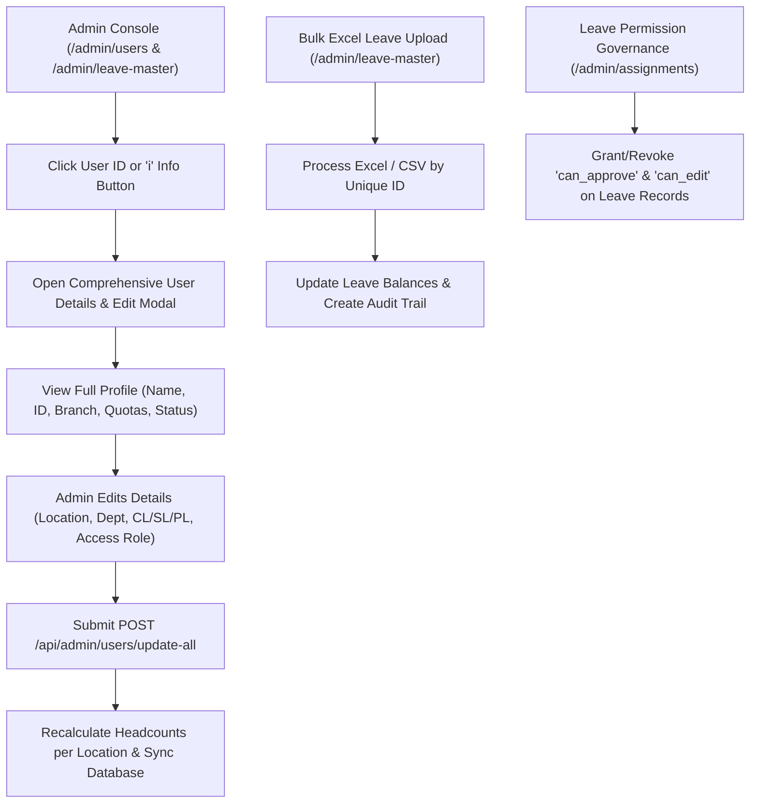

# Plan & Feature Specifications: Comprehensive Admin Management & Leave Control

## 1. Executive Summary & Goals
This enhancement addresses five core administrative and operational capabilities:
1. **Interactive Info ("i") & User ID Full Details Drawer**: Clicking the "i" button or the User's Unique ID in the management console immediately opens a comprehensive details panel displaying full employee biographical data, location allocations, leave quotas, ledgers, and contact information.
2. **Headcount & Location Count Discrepancy Fixes**: When reviewing user details, if there is a mismatch in active counts vs. assigned locations, Admin can directly update location, department, and active status to keep counts synchronized in real-time.
3. **Bulk Excel/CSV Leave Statement & Quota Ingestion**: Seamless file upload system that matches employees by `Unique ID` / `ECN` / `Email` and automatically refreshes CL, SL, PL, and CO balances.
4. **Leave Editing & Approval Delegation**: Admin control interface allowing administrators to delegate or restrict who can edit, approve, or manage leave records (HR, Location Managers, or specific Team Leads).
5. **Full In-Place User Editor**: Clicking any user allows editing of all personal, operational, quota, and location data in one cohesive view.

---

## 2. Architecture & Workflow



---

## 3. Detailed Component Plan

### A. User Details & Full Editing Modal (`templates/users.html` & `main.py`)
- **Interactive Info / User ID Click**:
  - The `Unique ID` (e.g. `AIPLCC175`) and a dedicated blue Info icon (`i`) are clickable.
  - Opens a modal with tabs or structured cards:
    1. **Profile & Identification**: Name, Email, Unique ID, BM ID, CRM ID, ECN.
    2. **Branch & Organization**: Operational Location (Mumbai, Pune, Nagpur, HQ), Department, Team Leader.
    3. **Leave Balances**: Casual Leave (CL), Sick Leave (SL), Paid Leave (PL), Comp-Off (CO).
    4. **Status & Role**: Active / Offboarded, Role Title, Access Level (Admin, HR, Location Manager, Team Leader, Employee).
- **Backend Endpoint (`/api/admin/users/update-all`)**:
  - Saves all modified attributes.
  - Automatically reconciles active staff count for the previous and new operational branch.

### B. Accurate Real-Time Location Count Reconciliation
- Recalculates location statistics dynamically:
  ```python
  active_count = db.query(User).filter(User.location_id == loc.id, User.is_active == True).count()
  ```
- Instant UI refresh without needing a server restart.

### C. Excel Leave Data Upload & Sync (`/admin/leave-master` & `excel_service.py`)
- Upload monthly Excel/CSV file with columns: `Unique ID` / `Employee Code`, `CL Balance`, `SL Balance`, `PL Balance`, `Taken CL`, `Taken SL`.
- Matches records by `unique_id` or `ecn`.
- Updates balances and logs ledger entries for audit compliance.

### D. Leave Editing & Approval Authority Governance (`/admin/assignments`)
- Admin assigns role authorizations:
  - `can_approve`: Authorizes approving/rejecting leave applications.
  - `can_edit`: Authorizes manual balance adjustments and schedule modifications.
  - Direct delegation by location or department so Location Managers only approve their branch's leave.

---

## 4. Implementation Steps
1. **Frontend**: Add the comprehensive details/edit modal to `templates/users.html` and wire both the "i" info icon and `Unique ID` link to trigger it.
2. **Backend**: Implement `/api/admin/users/full-details/{user_id}` and `/api/admin/users/update-all` in `main.py`.
3. **Leave Excel Ingestion**: Ensure the Excel upload button on `/admin/leave-master` and `/admin/sync` binds properly to `excel_service.py`.
4. **Testing & Verification**: Test clicking user ID, editing fields, updating branch, and verifying that the count on the login and dashboard screens updates accurately.
5. **Git Commit & Push**: Commit all updates and push to GitHub repository.

