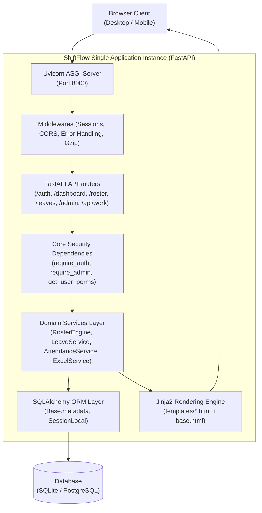

# ShiftFlow Enterprise: Full-Stack Single-Application Architecture Blueprint

## Executive Overview
ShiftFlow Pro is currently architected as a high-performance **Full-Stack Single Application** combining a FastAPI backend, Jinja2/Tailwind UI frontend, SQLite/PostgreSQL ORM layer, and asynchronous background tasks into a unified runtime. 

To maintain maintainability as the codebase grows beyond 3,500+ lines in `main.py`, this blueprint outlines the target **Modular Single-Application Layout**. This structure preserves zero-downtime monolithic simplicity (single command execution: `uvicorn app.main:app`) while decoupling routes, business logic, ORM models, and static assets into distinct domain boundaries.

---

## 1. Target Directory & Module Structure

```
shiftflow-pro/
├── app/
│   ├── __init__.py
│   ├── main.py                     # App factory, middlewares, exception handlers, static mounts
│   ├── config.py                   # Environment settings (Pydantic BaseSettings)
│   ├── database.py                 # Engine, SessionLocal, Base, get_db dependency
│   │
│   ├── core/                       # Core cross-cutting concerns
│   │   ├── __init__.py
│   │   ├── auth.py                 # Password hashing, cookie sessions, require_auth, require_admin
│   │   ├── permissions.py          # Granular RBAC, Location Scoping, IDOR guardrails
│   │   └── audit.py                # Audit logging engine (log_audit_event)
│   │
│   ├── models/                     # SQLAlchemy declarative models (by domain)
│   │   ├── __init__.py             # Exports all models for Alembic/metadata.create_all
│   │   ├── user.py                 # User, UserAssignment, UserPreference, UserSessionLog
│   │   ├── roster.py               # RosterEntry, Shift, ShiftChangeHistory, RosterViewLog
│   │   ├── leave.py                # LeaveRequest, LeaveBalance, LeaveHistory, LeaveAttachment
│   │   ├── operations.py           # WorkSession, SessionBreak, CompanySetting, Holiday
│   │   └── organization.py         # Location, Department, Team, Notification
│   │
│   ├── schemas/                    # Pydantic validation & transfer schemas
│   │   ├── __init__.py
│   │   ├── user.py                 # UserCreate, UserUpdate, UserResponse
│   │   ├── work_session.py         # WorkShiftStart, BreakRequest, WorkShiftSummary
│   │   ├── leave.py                # LeaveApplySchema, LeaveApprovalSchema
│   │   └── preferences.py          # UserPreferenceSchema
│   │
│   ├── services/                   # Pure business logic (decoupled from HTTP)
│   │   ├── __init__.py
│   │   ├── roster_engine.py        # 24/7 rotation solver, gap validation, night shift caps
│   │   ├── leave_service.py        # Quota deductions, pro-rata balance math, comp-off accruals
│   │   ├── attendance_service.py   # Punch/session calculation, net hours, excess break detection
│   │   ├── excel_service.py        # Excel muster roll parser, bulk upload, sample generator
│   │   └── notification_service.py # Bell alerts, leave status pushes, audit warnings
│   │
│   └── routers/                    # FastAPI APIRouter endpoints (organized by role & feature)
│       ├── __init__.py
│       ├── auth.py                 # /login, /logout, /signup, /switch-persona
│       ├── dashboard.py            # /dashboard, /api/dashboard/headcount-metrics
│       ├── roster.py               # /roster, /roster/manage, /roster/location, /roster/combined
│       ├── leaves.py               # /leaves, /leaves/apply, /leaves/approve, /leaves/revoke
│       ├── work_tracking.py        # /api/work/start-shift, /api/work/end-shift, /api/work/*-break
│       ├── admin_users.py          # /admin/users, /api/admin/users/update-all, details modal
│       ├── admin_shifts.py         # /admin/shifts, /admin/shifts/create, /admin/shifts/delete
│       └── admin_settings.py       # /admin/settings, /admin/settings/update-rules, holidays
│
├── templates/                      # Jinja2 Templates (HTML5 + Tailwind CDN + Lucide Icons)
│   ├── base.html                   # Universal dark-mode shell, role-based sidebar, shortcuts modal
│   ├── dashboard.html              # Main dashboard, work shift timer, KPI analytics, alerts
│   ├── login.html                  # Location-based security login
│   ├── signup.html                 # Self-service staff registration
│   ├── roster.html                 # 7/14-day interactive master roster matrix
│   ├── manage_roster.html          # Manager daily shift desk & attendance verification
│   ├── location_roster.html        # Branch-wise roster breakdown
│   ├── combined_roster.html        # Consolidated operations view
│   ├── leaves.html                 # Leave approvals, quota ledger, file evidence preview
│   ├── settings.html               # 24/7 Operations hub, company fatigue rules, holiday master
│   ├── shift_management.html       # Shift template configurations & time slots
│   └── users.html                  # User directory, full profile modal, permission matrix
│
├── static/                         # Static assets
│   ├── css/                        # Custom stylesheets
│   ├── js/                         # Client-side helper scripts
│   └── img/                        # Logos, icons, branding
│
├── uploads/                        # User-submitted evidence & exports
│   └── leave_evidence/             # Medical certificates and PDF attachments
│
├── tests/                          # Automated test suite
│   ├── __init__.py
│   ├── conftest.py                 # TestClient fixture, test DB setup
│   ├── test_auth.py                # Login, signup, logout duration tracking tests
│   ├── test_rbac_security.py       # Role scoping, IDOR prevention, admin authority
│   ├── test_work_sessions.py       # Shift starts, breaks, net time calculation
│   └── test_leave_lifecycle.py     # Application, quota deduction, revocation, cancellations
│
├── requirements.txt                # Python package dependencies
├── run_audit_tests.py              # Single-command test runner
└── shiftflow.db                    # SQLite primary database
```

---

## 2. Core Architectural Principles of the Single-App Design



### 1. Unified Process & Single Deployment Unit
- The entire system runs from a single process without needing separate frontend build servers (Node.js/Next.js) or multi-container synchronization.
- Python handles HTTP routing, business logic, authentication, HTML rendering, and JSON APIs concurrently.

### 2. Separation of HTTP Routing from Business Logic (Service Pattern)
- Routes in `app/routers/` are thin controllers responsible only for receiving requests, running authentication checks, calling services, and returning HTML or JSON responses.
- Heavy computational tasks (such as fatigue checking, 12-hour rest enforcement, or quota deductions) reside in pure functions under `app/services/`.

### 3. Modular APIRouters
- Instead of a single 3,500-line `main.py`, routers are split by domain using `APIRouter()` and cleanly registered in `app/main.py`:
  ```python
  app.include_router(auth.router)
  app.include_router(dashboard.router)
  app.include_router(roster.router)
  app.include_router(leaves.router)
  app.include_router(work_tracking.router)
  app.include_router(admin_settings.router)
  ```

### 4. Zero-Flicker Role-Based UI Architecture
- The presentation layer uses `templates/base.html` as the universal dark-mode frame (`#0B1120`), featuring the customizable sidebar with database-persisted shortcut preferences (`UserPreference`).
- Pages inherit from `base.html` via Jinja2 template inheritance, eliminating boilerplate across views.

---

## 3. Migration Roadmap (Step-by-Step)

To safely refactor into this structure without disrupting the live operational server:

1. **Step 1: Create Packaging Skeleton (`app/`)**
   - Create directories: `app/core/`, `app/models/`, `app/routers/`, `app/services/`, `app/schemas/`.
2. **Step 2: Relocate Core & Database Modules**
   - Move `database.py` and `auth.py` into `app/core/`.
   - Re-export models through `app/models/__init__.py`.
3. **Step 3: Extract Routers Sequentially**
   - Extract Authentication & Registration (`app/routers/auth.py`).
   - Extract Work Sessions & Breaks (`app/routers/work_tracking.py`).
   - Extract Leave Lifecycle (`app/routers/leaves.py`).
   - Extract Settings & 24/7 Rules (`app/routers/admin_settings.py`).
   - Extract Master & Location Rosters (`app/routers/roster.py`).
4. **Step 4: Centralize `app/main.py`**
   - Clean up `main.py` to become the master app factory registering all routers and static mounts.
5. **Step 5: Run Automated Verification Suite**
   - Execute `run_audit_tests.py` and `test_leave_lifecycle.py` to confirm 100% backward compatibility.
