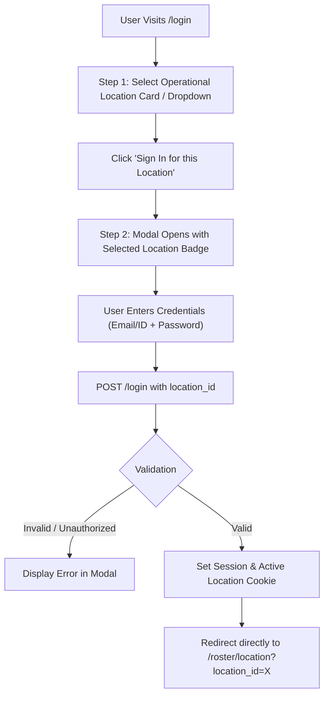

# Implementation & Architecture Plan: Location-First Authentication Flow

## 1. Overview & Objective
Currently, users navigate directly to the `/login` page, enter their email or Unique ID and password, and are redirected to the general `/dashboard`. When navigating to the Location Roster, the system auto-selects a default location or requires manual dropdown selection.

**Requested Requirement:**
1. **Location-First Selection**: User first chooses or enters their operational location (e.g. Mumbai, Pune, Nagpur, Headquarters) on a welcoming landing screen.
2. **Interactive Login Modal / Dialog**: Once a location is selected, a sleek login pop-up (modal) appears with that location pre-selected/locked.
3. **Location-Centric Post-Login Experience**: Upon successful authentication:
   - The user is validated against the selected location (or granted access if an Admin/Super Admin/HR with multi-location rights).
   - The user is redirected directly to that location's dedicated roster and operational workspace (`/roster/location?location_id=<id>`), with location-specific statistics, shifts, and employees loaded immediately.
   - Session/cookie preserves the active operational location.

---

## 2. Proposed Architecture & Workflow

---

## 3. Detailed Component Plan

### A. Location-First Landing & Modal UI (`templates/login.html`)
- **Step 1: Visual Location Selector**:
  - Show active locations (e.g., Mumbai, Pune, Nagpur, Headquarters) as interactive cards with status indicators (e.g. "Active Operations", number of active staff or live status).
  - Also include a searchable select box for scalability if more substations or zones are added.
- **Step 2: Modal Dialog (Pop-up)**:
  - Clicking on a location opens a modal dialog with smooth animations.
  - Modal prominently displays: `Logging in to: [Location Name]`.
  - Hidden input `location_id` passed with credentials.
  - Option to switch location or sign in as Global Administrator.

### B. Backend Route Updates (`main.py`)
- **`GET /login`**:
  - Query all active `models.Location` entries and pass them to the template context (`locations=locations`).
  - Accept optional `?location_id=` query param so bookmarking or linking to a specific location auto-triggers its modal.
- **`POST /login`**:
  - Receive `identifier`, `password`, and optional `location_id: Optional[int]`.
  - Validate credentials.
  - Check location permission:
    - If user is `Admin`, `Super Admin`, or `HR` without restrictions, allow any chosen location.
    - If user is `Location Manager`, `Team Leader`, or `Employee`, check whether their `user.location_id == location_id` or active assignment covers it. If mismatched, present a clear, helpful message: *"You are assigned to Pune location; please select your assigned branch."*
  - On success, set `active_location_id` in session/cookie and redirect to:
    - `/roster/location?location_id={selected_location_id}` (or `/dashboard` if no location selected or employee role).

### C. Location Roster & Navigation Improvements (`templates/location_roster.html` & `templates/base.html`)
- Display the active location clearly in the top navbar banner with a "Switch Branch" quick-action.
- Ensure that if an employee logs in, they see their location roster seamlessly.
- If no roster entries exist yet for the current week, provide an instant "Generate Default Schedule" or "Add Shift" button instead of an empty table.

---

## 4. Improvements & Enhancements
1. **Multi-location Access Control**: Admins can quickly switch locations without logging out via the top navbar switch pill.
2. **Remember Last Branch**: Store `last_selected_location` in `localStorage` so repeat visits automatically open the modal for their regular workplace.
3. **Direct Station Portal**: Each location gets a direct URL (e.g. `/login?location_id=1` for Mumbai) that can be bookmarked by branch teams.
4. **Audit Trail**: Record the login location in `RosterViewLog` or `AuditLog` to monitor from which branch users are accessing shift schedules.
