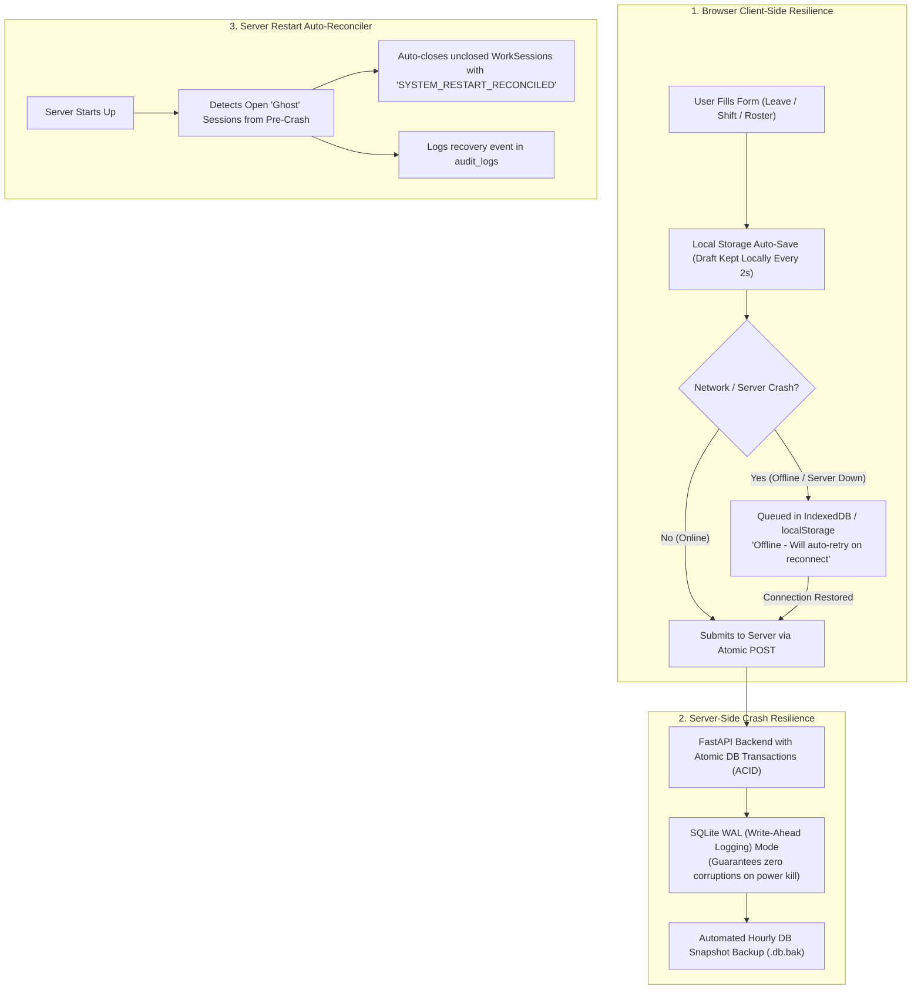

# System Crash Recovery, Offline Form Protection & User Data Tracking Architecture

## 1. Problem Statement
In a 24/7 mission-critical operational system (like MSEDCL electricity and support dispatching), unexpected incidents happen:
1. **System / Server Crash or Restart**: Server reboots, power cuts, or process terminations while users are working or submitting forms.
2. **Network / Internet Drop during Form Submission**: An employee fills out a detailed leave application or a manager enters shift changes, but clicks Submit just as the network drops or server restarts.
3. **Session Loss / Incomplete Punches**: A user started their shift or break, but the browser crashed or PC restarted before they could clock out or resume.

This document details the architectural plan to ensure **zero data loss**, **offline form preservation**, **auto-recovery upon restart**, and **exact tracking of each user's complete data footprint**.

---

## 2. Crash Recovery & Resilience Architecture



---

## 3. Five-Pillar Strategy for 100% Data Safety

### Pillar 1: Client-Side Draft Auto-Save (Never Lose Form Data)
- **Automatic Form Draft Saving**: When an employee types into the Leave Application form, Attendance Regularization, or Roster Quick Assign:
  - Every keystroke is saved to browser `localStorage` (`shiftflow_draft_leave`, `shiftflow_draft_roster`).
  - If the browser crashes, computer turns off, or server reboots, the form automatically **restores all entered fields** when reopened:
    > *"Draft restored from your last unsaved session (2 minutes ago)."*
- **Offline Submit Buffer**:
  - If a user clicks **Submit** while the server is temporarily down, the client intercepts the HTTP failure.
  - Rather than displaying a blank error screen, it saves the payload into `localStorage.pending_offline_submissions` and periodically pings `/api/health`.
  - Once the server is reachable, it auto-submits the pending data and notifies the user with a green alert toast.

---

### Pillar 2: SQLite Write-Ahead Logging (WAL) Mode
Currently, standard SQLite file locking can cause busy errors or incomplete writes during unexpected power loss.
- **Immediate Improvement**: Enable **WAL Mode** in `database.py`:
  ```python
  @event.listens_for(engine, "connect")
  def set_sqlite_pragma(dbapi_connection, connection_record):
      cursor = dbapi_connection.cursor()
      cursor.execute("PRAGMA journal_mode=WAL")
      cursor.execute("PRAGMA synchronous=NORMAL")
      cursor.execute("PRAGMA busy_timeout=5000")
      cursor.close()
  ```
- **Benefit**:
  - High concurrency: Readers never block writers, and writers never block readers.
  - Crash survivability: Incomplete transactions roll back cleanly; committed transactions persist immediately.

---

### Pillar 3: Server Restart Auto-Reconciliation Engine (Startup Hook)
When the application restarts after an unexpected crash or reboot:
- A FastAPI `@app.on_event("startup")` lifecycle hook scans the database for:
  1. **Hanging User Sessions (`user_session_logs`)**:
     - Sessions where `is_active_session == True` but no heartbeat occurred prior to crash.
     - Auto-marks `is_active_session = False` and sets `logout_time = last_activity_time` with note: *"Reconciled after server restart"*.
  2. **Orphaned Work Shifts (`work_sessions`)**:
     - Shifts left in `ACTIVE` or `ON_BREAK` across day boundaries.
     - Automatically flags them for supervisor review rather than leaving them in limbo.
  3. **Audit Log Recording**:
     - Records `SYSTEM_RESTART_EVENT` in `audit_logs` with UTC timestamp and reconciled record counts.

---

### Pillar 4: Automated Database Snapshots & Rolling Backups
- A lightweight background task creates rolling snapshot backups:
  - Daily snapshot: `backups/shiftflow_daily_YYYY-MM-DD.db` (retained for 30 days).
  - Pre-migration backup: automatically triggered before schema updates.
  - In case of disk corruption or catastrophic host failure, recovery takes under 10 seconds by swapping the database file.

---

## 4. Where Each User's Data Is Tracked (Data Footprint Matrix)

Every piece of employee data is tracked across dedicated normalized tables in `shiftflow.db`:

| Category | What is Tracked | Database Table | Columns & Metrics Tracked |
| :--- | :--- | :--- | :--- |
| **Profile & Access** | Identity, Role, Station | `users` | `name`, `email`, `unique_id`, `role_title`, `access_level`, `location_id`, `is_active` |
| **Website Online Time** | Logins, Logouts, Duration | `user_session_logs` | `login_time`, `logout_time`, `duration_seconds`, `ip_address`, `user_agent`, `is_active_session` |
| **Operational Shifts** | Planned Shift & Rotation | `roster_entries` | `date`, `shift_code_or_time`, `status`, `approval_status`, `updated_by`, `updated_at` |
| **Shift Productivity** | Actual Shift Work & Hours | `work_sessions` | `session_date`, `start_time`, `end_time`, `gross_duration_mins`, `total_break_mins`, `net_work_mins` |
| **Break Times** | Lunch, Tea, Dinner Breaks | `session_breaks` | `break_type`, `start_time`, `end_time`, `duration_mins`, `is_excess` (flags breaks > 45m/15m) |
| **Leave Applications** | Submitted Leave Requests | `leave_requests` | `application_number`, `leave_type`, `start_date`, `end_date`, `duration_days`, `status`, `reason`, `reviewed_by` |
| **Leave Quotas** | Remaining Balances | `leave_balances` | `month_year`, `eligible_cl`, `eligible_sl`, `balance_cl`, `balance_sl`, `balance_co` |
| **Evidence & Docs** | Medical certificates, PDFs | `leave_attachments` | `file_path`, `file_name`, `file_size`, `mime_type` (saved on disk under `uploads/leave_evidence/`) |
| **UI Preferences** | Custom Sidebar Shortcuts | `user_preferences` | `sidebar_pinned` (JSON array of pinned modules) |
| **Tamper-Proof Audit** | Every single user action | `audit_logs` | `actor_id`, `actor_name`, `action`, `resource_type`, `resource_id`, `details`, `timestamp` |

---

## 5. Summary: How Data Is Protected at Every Stage

1. **Before Click**: Form data is continuously cached in browser local storage.
2. **During Submit**: Wrapped in atomic SQL transactions with SQLite WAL mode.
3. **If Server is Down**: Client keeps the data in offline buffer and retries once connection is restored.
4. **After Crash / Restart**: Server startup hook automatically reconciles all open sessions and records recovery logs.
5. **Historical Integrity**: Every change is mirrored in the immutable `audit_logs` table for compliance and forensic auditing.
