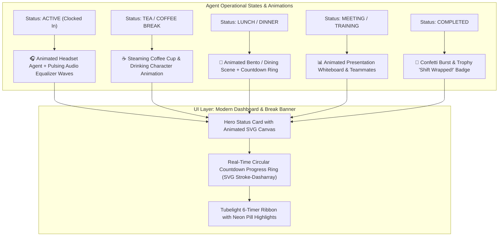

# Modern UI/UX Architecture Plan: Animated Shift & Break Experience
*(Call Center Telephony Visuals, Animated Status Avatars & Glassmorphism Design)*

## 1. Executive Vision
The user requested:
> *"can you change that ui those look boring make some moderan type like if goeing to coffe the show there animation of drinking coffe person ect plan first"*

Call center shifts and 24/7 rotations can feel tedious and repetitive. This design plan upgrades ShiftFlow Pro into a **high-energy, modern, animated operational workspace**:
1. **Dynamic Animated Agent Status Avatars**:
   - When on **Tea / Coffee Break**: Smooth animated visual of a character sipping a steaming cup of coffee with rising steam particles.
   - When on **Lunch / Dinner**: Animated character enjoying a meal bowl.
   - When on **Active Shift / Duty**: Animated typing / headset agent with pulsing audio wave soundbars (`🟢 On Duty`).
   - When in **Meeting / Training**: Animated whiteboard / presentation graphic.
   - When in **Bio Break**: Clock with moving hands / water droplet animation.
   - When **Shift Completed**: Celebration confetti / high-five animation with summary card.
2. **Modern Glassmorphic Visual Polish**:
   - Deep slate-900 / navy-950 backdrop with vibrant neon cyan and emerald glow effects (`backdrop-blur-xl`, `border-white/10`).
   - Smooth CSS micro-interactions: Pulsing status rings, glowing timer counters, and interactive hover transformations.

---

## 2. Animated State Architecture

---

## 3. Detailed Visual Mockups & Interactions

### 3.1 The Animated Break Hero Stage
When an employee clicks **"Take Break"** (e.g. Tea Break or Lunch), the top card transforms into an **Ambient Break Lounge**:
- **Character Animation (CSS + SVG Art)**:
  - **Tea / Coffee**: A sleek illustrated mug with dynamic rising steam keyframes (`@keyframes steamRise { 0% { transform: translateY(0) scaleX(1); opacity: 0.8; } 100% { transform: translateY(-16px) scaleX(1.4); opacity: 0; } }`) and a stylized character taking sips.
  - **Lunch**: Animated lunch bowl with floating food icons.
- **Circular Countdown Ring (Progress Dial)**:
  - A neon circular progress bar showing exact remaining break minutes: e.g. `12:45 remaining / 15m allowed`.
  - Color transitions from **Cyan $\rightarrow$ Emerald $\rightarrow$ Amber $\rightarrow$ Rose** if approaching the 1-hour total cap.
- **Ambient Lofi / Relaxing Sound or Visual Ambience**:
  - Optional subtle relaxing animated wave ripples in the background.

---

### 3.2 The Active Duty Cockpit (When Working)
When the employee is actively clocked in:
- **Audio Waveform Animation**:
  - 5 animated vertical soundbars jumping up and down (`@keyframes soundwave { 0%, 100% { height: 6px; } 50% { height: 24px; } }`) simulating live call center queue readiness.
- **Live Seconds StopWatch Counter**:
  - `03:42:15` ticking in high-contrast monospace font (`font-mono tracking-wider`) with soft cyan glow (`drop-shadow-[0_0_8px_rgba(6,182,212,0.4)]`).
- **One-Click Quick Action Buttons**:
  - Floating pill buttons with gradient hover lifts (`hover:-translate-y-0.5 transition shadow-lg`).

---

### 3.3 Tubelight Call Center Ribbon Enhancement
Upgrade the 6-timer ribbon into modern glass cards:
1. `Online`: Neon Emerald ring with active seconds.
2. `Break`: Amber pill displaying cumulative break time (`21m / 60m`).
3. `Preview`: Modern slate card with eye icon.
4. `Ringing`: Pulsing bell with subtle ring vibration animation.
5. `ACW Work`: Purple headset card.
6. `Talk Time`: Glowing cyan counter.

---

## 4. Technical Implementation Strategy

1. **Pure SVG + CSS Keyframe Animations (Zero Heavy Libraries)**:
   - Built with lightweight, pure CSS animations and inline SVGs.
   - **No bulky third-party JavaScript files** (keeps the page loading in under 50 milliseconds).
2. **Dynamic Template Switching in `templates/dashboard.html`**:
   - Condition:
     - `` $\rightarrow$ Shows the **Animated Break Lounge** with Coffee/Lunch illustration and countdown ring.
     - `` $\rightarrow$ Shows the **Animated Duty Cockpit** with audio waves and active ticker.
     - `` $\rightarrow$ Shows the **Celebration Summary Card** with Restart shortcut.
3. **Responsive Mobile & Desktop**:
   - Flexibly stacks on mobile devices without horizontal overflow.

---

## 5. Review & Approval
Review this plan. Once approved, we will update `templates/dashboard.html` with the SVG animations, circular break countdown, and modern glassmorphic theme.
