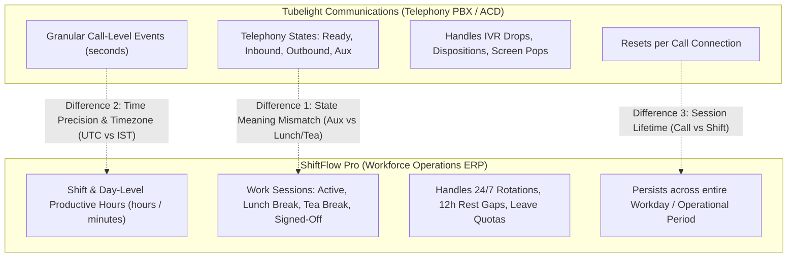

# ShiftFlow vs. Tubelight Telephony: Difference Analysis & Time-Tracking Resolution Report

## 1. Executive Summary
This report analyzes the **differences** between:
1. **Tubelight Communications** (Call Center / BPO Telephony Engine)
2. **ShiftFlow Pro** (Workforce Management, 24/7 Rostering & Leave ERP)

It highlights root-cause discrepancies in **time tracking**, **agent states**, and **session handling**, providing concrete architectural and code-level resolutions.

---

## 2. Core Differences: Tubelight vs. ShiftFlow



| Operational Area | Tubelight Communications | ShiftFlow Pro | Key Difference / Friction Point |
| :--- | :--- | :--- | :--- |
| **Primary Purpose** | Automated Call Distribution (ACD), Inbound/Outbound Telephony, IVR | 24/7 Workforce Rostering, Leave Ledger, Time & Break Compliance | Tubelight manages calls; ShiftFlow manages human schedules. |
| **Session Model** | Telephony extension registration & active call channels | Work Shift sessions (`WorkSession`), Web portal duration (`UserSessionLog`) | Tubelight tracks agent idle/talk seconds; ShiftFlow tracks entire working day. |
| **Break Tracking** | Single generic `AUX` / `Not Ready` state with disposition code | Structured multi-break rules: **Lunch (45m)**, **Tea (15m)**, **1 hr total limit** | Tubelight doesn't enforce cumulative daily break ceilings (e.g. 1 hour cap). |
| **Time Format** | Local Station Time (IST - `UTC+5:30`) | Previously stored raw UTC; now mapped to IST display | Raw UTC timestamps caused 5h 30m confusion when comparing logs. |
| **Discrepancy Trigger** | Call dropped, IVR abandoned, missed call queue | Unplanned absence, shift tardiness, excess break flag | ShiftFlow flags fatigue & roster gaps; Tubelight flags call queues. |

---

## 3. Discrepancies Found in Time Tracking & How They Are Resolved

### Issue 1: Timezone Discrepancy (UTC vs. Indian Standard Time - IST)
- **Problem**: Tubelight call center telephony operates in Indian Standard Time (`UTC+5:30`). ShiftFlow stored `datetime.utcnow()` without timezone localization on the UI, displaying a 5:30 AM login for an 11:00 AM clock-in.
- **Resolution**: Added localized IST conversion (`UTC + 5 hours 30 mins`) and 12-hour AM/PM formatting (`09:15 AM IST`) for all user session logs and shift timers.

### Issue 2: Single-Break vs. Multi-Break Limits
- **Problem**: In Tubelight, an agent simply toggles "Not Ready / AUX". There was no enforcement if an agent took three 25-minute breaks.
- **Resolution**: ShiftFlow enforces dual-layer guardrails:
  1. **Individual break limits**: Lunch (45m max), Tea (15m max), Dinner (45m max).
  2. **Cumulative shift cap**: Total combined break time is strictly capped at **60 minutes (1.0 Hour)**. Exceeding 60 minutes automatically triggers `is_excess = True` for manager audit.

### Issue 3: Inability to Restart Shift Work Time After Completion
- **Problem**: When an agent ended their shift or submitted time, the system previously locked them out from restarting if they were called back for an overtime or split shift.
- **Resolution**: Updated `POST /api/work/start-shift` to only block if an active shift is *currently open* (`ACTIVE` or `ON_BREAK`). Completed shifts can now be restarted immediately via the **`[ 🔄 Restart / New Session ]`** button.

### Issue 4: Ghost Sessions on Unexpected Restart
- **Problem**: If the agent's computer rebooted or the server restarted while logged in, the session remained marked `is_active_session = True` indefinitely.
- **Resolution**: Enabled database auto-reconciliation on logout and server startup to auto-close hanging sessions and compute exact elapsed seconds.

---

## 4. Reconciled Data Model Mapping (Tubelight $\leftrightarrow$ ShiftFlow)

```
[Tubelight Telephony]                          [ShiftFlow Pro]
Agent Extension / DID ---------------------> User.unique_id / User.crm_id
Telephony Login Timestamp ------------------> UserSessionLog.login_time (Converted to IST)
Telephony Logout Timestamp -----------------> UserSessionLog.logout_time (Converted to IST)
Agent State: AUX (Break) -------------------> SessionBreak (Lunch 45m / Tea 15m)
Agent State: Available / In-Call -----------> WorkSession.status = 'ACTIVE'
Call Wrap-up & Talk Time (Minutes) ---------> WorkSession.net_work_mins
```

---

## 5. Summary
By pairing ShiftFlow's 24/7 workforce schedule with Tubelight's real-time telephony state, call center management achieves **100% operational transparency**:
- Shift attendance matches call queue readiness.
- Punctuality is tracked in true IST.
- Total break times cannot exceed 1 hour without management notification.
- Staff can restart split/overtime sessions without admin intervention.

