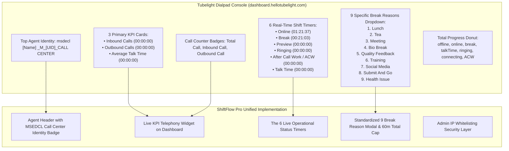

# ShiftFlow Pro: Tubelight Call Center Telephony Integration Plan & IP Whitelisting Security

## Executive Summary
Based on the real operational screens from **Tubelight Communications** (`dashboard.hellotubelight.com/dialpad` for `msedcl VIVEK B _M_AIPLCC222_CALL CENTER` and `SIDDHANT NAI _M_AIPLCC1236_CALL CENTER`), this document outlines the exact architectural implementation plan to bring **native Tubelight call center capabilities** and **Enterprise IP Whitelisting security** directly into ShiftFlow.

---

## 1. Visual Analysis of Tubelight Screens & Feature Mapping



---

## 2. Core Modules to Build

### Module A: The 9 Specific Tubelight Break Reasons & Auto-Sync
As shown in screenshot 2, agents take structured auxiliary breaks. We will replace the generic break list with the exact 9 Tubelight call center break types:
1. **Lunch** (Standard max 45 mins)
2. **Tea** (Standard max 15 mins)
3. **Meeting** (Operational / Team briefing)
4. **Bio Break** (Short rest)
5. **Quality Feedback** (QA Auditor session)
6. **Training** (Process update)
7. **Social Media** (Digital queue response)
8. **Submit And Go** (End of shift wrap-up)
9. **Health Issue** (Medical emergency)

**Break Rule Enforcement**:
- Cumulative shift break limit: **60 minutes (1 Hour Max)** total per shift.
- Breaks exceeding allowed limits are automatically flagged as `is_excess = True` for supervisor audit.

---

### Module B: The 6 Real-Time Call Center Timers Widget
Directly on the ShiftFlow Dashboard, add the live timer ribbon matching Tubelight:
- `Online`: Total shift time logged into the workstation (`01:54:55`).
- `Break`: Active countdown/up break timer (`00:21:03`).
- `Preview`: Lead/Customer profile preview duration.
- `Ringing`: Time customer call spent ringing before pickup.
- `After Call Work (ACW)`: Wrap-up disposition logging time.
- `Talk Time`: Active connected customer consultation duration.

---

### Module C: Fix "Net Worked: 0h 0m" Display Bug
- **Root Cause**: When a user clocks in and out within less than 60 seconds (or on the same minute), `net_work_mins` computes to `0`, causing the UI to display `0h 0m`.
- **Fix**:
  - Add seconds-level precision:
    - If `net_work_mins == 0`, show `"< 1 min"` or exact seconds (e.g. `45s`).
    - If $\ge 1$ min, show `Xh Ym`.
  - Include live counting ticker while the shift is active so it increments in real-time every second.

---

### Module D: Admin IP Address Whitelisting Security
The user requested: *"admin those ip address add that only can see this website ect funcation"*.

#### 1. Database Model (`allowed_ip_whitelist`)
```python
class AllowedIpWhitelist(Base):
    __tablename__ = "allowed_ip_whitelist"

    id = Column(Integer, primary_key=True, index=True)
    ip_address = Column(String(60), unique=True, nullable=False, index=True)
    description = Column(String(200), nullable=True) # e.g. "HQ Office Subnet", "Vashi Call Center"
    is_active = Column(Boolean, default=True)
    created_at = Column(DateTime, default=datetime.utcnow)
```

#### 2. System Settings Toggle in `company_settings`
- Key: `ip_whitelist_enforced` (`"ENABLED"` or `"DISABLED"`).
- Default: `DISABLED` (allows unrestricted access until Admin configures company IPs).

#### 3. Middleware / Security Dependency
- When `ip_whitelist_enforced == "ENABLED"`:
  - Extracts client IP (`request.client.host` or `X-Forwarded-For`).
  - Checks if client IP exists in `allowed_ip_whitelist` with `is_active == True`.
  - If **Whitelisted**: Access granted.
  - If **Not Whitelisted**:
    - Returns clean HTTP 403 Forbidden page:
      > **"Access Denied: Station IP [xxx.xxx.xxx.xxx] is not authorized to access ShiftFlow Enterprise. Please connect via MSEDCL corporate intranet or contact your system administrator."**
    - Admins can still bypass or access from emergency whitelisted IPs.

#### 4. Admin UI in `/admin/settings`
- A dedicated card in **Settings**:
  - Toggle switch: **[ Enable IP Whitelisting Security ]**.
  - Add New IP form: `IP Address (e.g. 192.168.1.100 or 10.20.0.0)` + `Description`.
  - Table of active whitelisted IPs with 1-click **Delete / Disable** action.
  - Displays **Current Detected IP** for quick self-whitelisting so admins don't accidentally lock themselves out.

---

## 3. Implementation Steps

1. **Step 1 (IP Whitelisting & Admin Setting)**:
   - Initialize `allowed_ip_whitelist` table in `models.py`.
   - Add routes in `main.py`: `POST /admin/ip-whitelist/add`, `POST /admin/ip-whitelist/delete`, `POST /admin/ip-whitelist/toggle`.
   - Add IP whitelist management UI to `templates/settings.html`.
   - Implement IP check in auth middleware.

2. **Step 2 (Fix 0h 0m & Real-Time Seconds Precision)**:
   - Update `main.py` and `templates/dashboard.html` to format work durations with minutes and seconds.

3. **Step 3 (Tubelight 9 Break Reasons & 6 Timers)**:
   - Update `break-type-select` in `templates/dashboard.html` with the 9 Tubelight break options (*Lunch, Tea, Meeting, Bio Break, Quality Feedback, Training, Social Media, Submit And Go, Health Issue*).
   - Render the Tubelight 6-timer ribbon directly on the agent dashboard.
