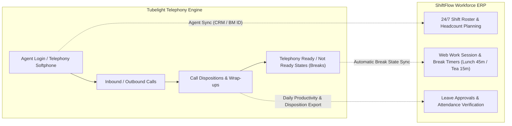

# Research & Integration Plan: Tubelight Communications Contact Center & Telephony

## 1. What is Tubelight Communications?
**Tubelight Communications** is an enterprise cloud telephony and CPaaS (Communication Platform as a Service) platform widely deployed across BPO operations, power distribution utilities (like MSEDCL call centers), and customer support operations.

As seen in your earlier dashboard screenshots, the agent telephony console features two primary layers:
1. **GLOBAL**:
   - `Voice`: Live incoming call channel
   - `Outbound`: Outbound calling campaigns
   - `Inbound`: Inbound customer helpline queue
   - `Voice Unique Numbers`: Caller DID identification
2. **AGENT**:
   - `Outbound`: Agent manual dialer
   - `Inbound`: Active call answering
   - `Outbound Drop`: Disconnected customer call tracking
   - `Ivr Drop`: Customers dropped before reaching an agent
   - `Ivr Dispose`: Handled IVR calls
   - `Missed Call`: Unanswered customer queries
   - `User Summary`: Per-agent call performance
   - `Dispose Summary`: Wrap-up / disposition code logs

---

## 2. Tubelight Call Center Telephony vs. ShiftFlow System Gap Analysis

### The Current Disconnect:
- **Agents currently have to manage two portals**:
  1. Tubelight console to take calls and mark call dispositions.
  2. ShiftFlow to check rosters, mark breaks, and apply for leaves.
- **Discrepancies in Break Time**: If an agent marks "Aux / Tea Break" in Tubelight, ShiftFlow doesn't know unless manually synced.
- **Roster vs. Actual Login Mismatch**: Managers cannot easily see if an agent scheduled on ShiftFlow for the `07:00 - 16:00` morning shift has actually logged into Tubelight telephony.

---

## 3. Tubelight Integration Architecture & Roadmap

### Feature 1: Agent Single Sign-On & Telephony ID Mapping
- Add `tubelight_agent_id` or `crm_id` to the `users` table (already supported in ShiftFlow's User profile).
- When an employee registers or logs in, their ShiftFlow account links directly with their Tubelight telephony agent ID.

### Feature 2: Tubelight Telephony Quick-Launcher / Floating Softphone
- Embed a quick access telephony drawer or floating action widget (as shown in your screenshot with the blue floating phone button):
  - 1-Click launcher to open Tubelight web phone or screen pop.
  - Live agent status pill: `🟢 Inbound Ready` | `🟡 In Call (03:45)` | `☕ Aux / Break (12m / 15m)`.

### Feature 3: Webhook / API Ingestion for Call Dispositions & Agent Performance
- Create an API webhook in ShiftFlow:
  - `POST /api/integrations/tubelight/call-event`
  - Ingests:
    - Call Start Time & End Time
    - Total Talk Time & Wrap-Up Time
    - Dispositions: *Resolved*, *Escalated*, *Follow-up Needed*, *Complaint Logged*
- Feeds into ShiftFlow's **WorkSession** to compute:
  $$\text{Productive Telephony Hours} = \text{Talk Time} + \text{Hold Time} + \text{Wrap Time}$$

### Feature 4: Automated Break & AUX Synchronization
- When an agent clicks **[ ☕ Take Break ]** in ShiftFlow (Lunch 45m / Tea 15m):
  - ShiftFlow triggers Tubelight API to set agent telephony state to `AUX_BREAK` (pauses incoming call queueing).
- When the agent clicks **[ 🟢 Resume Work ]**:
  - Sets Tubelight status back to `READY` to receive inbound calls.

### Feature 5: Shift Manager Unified Floor Inspection
- Under `/roster/manage` (Attendance & Swaps):
  - View side-by-side:
    - **Scheduled Shift** (e.g. 09:00 - 18:00)
    - **ShiftFlow Login** (e.g. 09:02 AM)
    - **Tubelight Telephony Login** (e.g. 09:04 AM)
    - **Current Telephony State** (`Inbound Ready`, `On Call`, `Idle`, `On Break`)
  - Enables supervisors to instantly spot unattended desks during peak consumer call hours.

---

## 4. Next Implementation Steps

1. **Step 1 (UI Widget)**: Add the Tubelight Quick Options / Launcher card directly on the ShiftFlow Dashboard and floating softphone trigger.
2. **Step 2 (Data Ingestion)**: Add a Tubelight CDR (Call Detail Record) / Disposition upload & webhook handler in `excel_service.py` to allow managers to upload daily Tubelight call summary reports.
3. **Step 3 (Reconciliation)**: Correlate Tubelight login hours with ShiftFlow work sessions for automated attendance verification.

